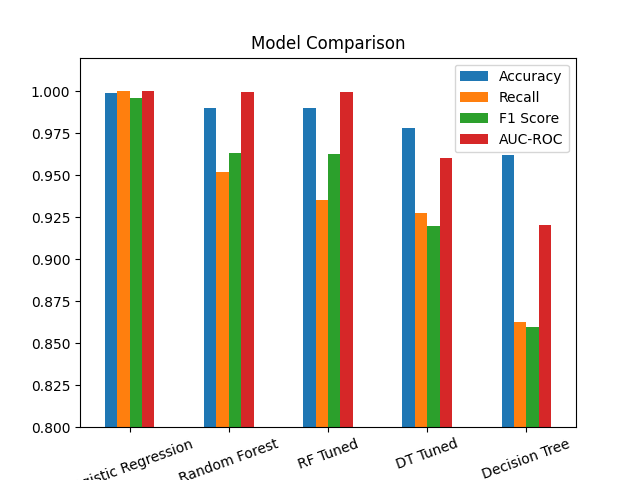
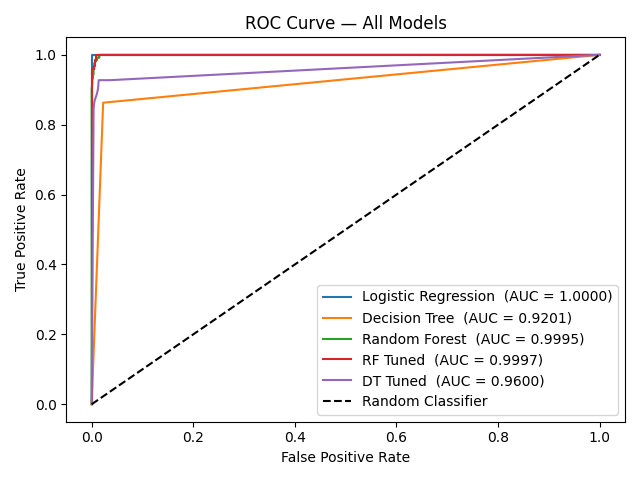
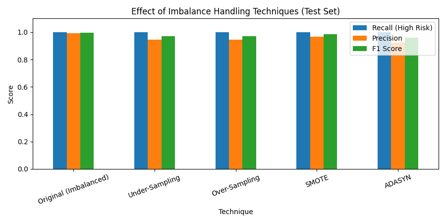

<div align="center">

# 🚨 Risk Alert Classifier

**A supervised machine-learning system that flags high-risk bank customers early, so risky accounts are reviewed before they turn into defaults or fraud losses.**


</div>

---

## 📑 Table of Contents

1. [Project Overview](#-project-overview)
2. [Key Results](#-key-results)
3. [Video Walkthrough](#-video-walkthrough)
4. [Dataset](#-dataset)
5. [Project Structure](#-project-structure)
6. [Methodology](#-methodology)
7. [Results & Visualizations](#-results--visualizations)
8. [Business Interpretation](#-business-interpretation)
9. [Installation & Usage](#-installation--usage)
10. [Tech Stack](#-tech-stack)
11. [Limitations](#-limitations)
12. [Future Work](#-future-work)
13. [Author](#-author)

---

## 📌 Project Overview

Banks lose money when a high-risk customer is missed. This project builds a **binary classifier** that predicts a customer's `risk_status`:

| Label | Meaning |
|:-----:|---------|
| `0` | Low Risk |
| `1` | High Risk |

The project covers the full supervised-learning workflow: data cleaning, imputation, encoding, scaling, baseline modelling, imbalance handling, tree-based models, hyperparameter tuning, ROC analysis and business interpretation.

Because only **~12% of customers are high risk**, accuracy alone is misleading (a model that predicts "Low Risk" for everyone would still be ~88% accurate). This project therefore prioritises **Recall, F1-score, AUC-ROC and the confusion matrix**, and in particular minimises **False Negatives** (missed risky customers).

---

## 🏆 Key Results

| | |
|---|---|
| **Best model** | Logistic Regression |
| **Recall (High Risk)** | **1.0000** (0 False Negatives) |
| **F1-score** | 0.9960 |
| **AUC-ROC** | 1.0000 |
| **Accuracy** | 0.9989 |
| **Selection criterion** | Fewest False Negatives, then fewest False Positives, then highest AUC-ROC |

---

## 🎥 Video Walkthrough

A recorded explanation of the project, covering the dataset, approach, model results and final conclusions.

🔗 **Link:** [Project Video Explanation](https://drive.google.com/file/d/1TdJgtQ40TaOWCNPrYSupNSsAgTVfcu8p/view?usp=sharing)

---

## 📊 Dataset

- **File:** `dataset/Risk_Alert_Classifier_Dataset_4600.csv`
- **Size:** 4,600 customers × 19 columns
- **Target:** `risk_status` (0 = Low Risk: 4,043 · 1 = High Risk: 557)
- **Missing values:** `age`, `region`, `employment_type`, `annual_income_inr`, `credit_score`, `credit_utilization_ratio`, `monthly_spend_inr`

| Category | Features |
|----------|----------|
| **Demographics** | `age`, `gender`, `region`, `employment_type` |
| **Financial** | `annual_income_inr`, `credit_score`, `credit_utilization_ratio`, `debt_balance_inr`, `monthly_spend_inr` |
| **Payment behaviour** | `missed_payments_12m`, `avg_late_payment_days`, `cash_advance_count_6m` |
| **Account activity** | `monthly_transaction_count`, `last_transaction_date`, `account_tenure_months` |
| **Service & security** | `complaints_last_6m`, `failed_login_attempts_3m` |
| **Identifier** | `customer_id` *(dropped before training)* |

---

## 📁 Project Structure

```text
PR3/
├── dataset/
│   └── Risk_Alert_Classifier_Dataset_4600.csv   # Raw dataset
├── Notebook/
│   └── Risk_Alert_Classifier.ipynb              # Full analysis (Parts A–H)
├── model/                                       # Saved trained model artifacts
├── Screenshots/
│   ├── imbalance_impact.png
│   ├── model_comparison.png
│   └── roc_curve.png
├── app.py                                       # Application / demo interface
├── train_model.py                               # Script to train and save the model
├── requirements.txt                             # Python dependencies
└── README.md
```

---

## 🔬 Methodology

The notebook is organised into eight parts:

| Part | Topic | Summary |
|:----:|-------|---------|
| **A** | Conceptual Understanding | Logistic Regression, classification metrics, Type-I / Type-II errors |
| **B** | Data Preparation | Date feature engineering, categorical encoding, KNN imputation, 80/20 split, standard scaling |
| **C** | Baseline Model | Logistic Regression with confusion matrix and classification report |
| **D** | Imbalance Handling | Under-Sampling, Over-Sampling, SMOTE, ADASYN |
| **E** | Tree-Based Models | Decision Tree and Random Forest, overfitting check |
| **F** | Hyperparameter Tuning | `RandomizedSearchCV` (DT, RF) and `GridSearchCV` (RF) |
| **G** | Evaluation | ROC curves and AUC-ROC for all models |
| **H** | Final Analysis | Best model selection, business interpretation, recommendations |

### Preprocessing pipeline

1. **Feature engineering:** `last_transaction_date` converted to `last_txn_days_ago` (days since the most recent date in the data).
2. **Dropped columns:** `customer_id` and `last_transaction_date`.
3. **Encoding:** `gender`, `region` and `employment_type` mapped to integer codes.
4. **Imputation:** `KNNImputer(n_neighbors=5)` for multivariate missing-value handling.
5. **Split:** 80% train (3,680) / 20% test (920), `random_state=42`.
6. **Scaling:** `StandardScaler` fitted on the training set only and applied to the test set.

### Models trained

- Logistic Regression (baseline)
- Decision Tree (untuned and tuned)
- Random Forest (untuned and tuned)

---

## 📈 Results & Visualizations

### 1. Model Comparison

All five models compared on the held-out test set (920 customers, 124 high risk).

| Model | Accuracy | Recall | F1 Score | AUC-ROC | False Negatives | False Positives |
|-------|:-------:|:------:|:--------:|:-------:|:---------------:|:---------------:|
| **Logistic Regression** | **0.9989** | **1.0000** | **0.9960** | **1.0000** | **0** | **1** |
| Random Forest | 0.9902 | 0.9516 | 0.9633 | 0.9995 | 6 | 3 |
| RF Tuned | 0.9902 | 0.9355 | 0.9627 | 0.9997 | 8 | 1 |
| DT Tuned | 0.9783 | 0.9274 | 0.9200 | 0.9600 | 9 | 11 |
| Decision Tree | 0.9620 | 0.8629 | 0.8594 | 0.9201 | 17 | 18 |

<p align="center">
  
  <br/>
  <em>Figure 1: Accuracy, Recall, F1-score and AUC-ROC across all models.</em>
</p>

**Takeaways**
- Logistic Regression is the best performer with **zero missed high-risk customers**.
- A single Decision Tree overfits the most (100% train accuracy vs. 96.2% test accuracy). Random Forest generalises better.
- Hyperparameter tuning improved the Decision Tree (recall 0.863 → 0.927) but did not improve the Random Forest's recall.

---

### 2. ROC Curve Analysis

<p align="center">
  
  <br/>
  <em>Figure 2: ROC curves for all models against a random-classifier baseline.</em>
</p>

| Model | AUC-ROC |
|-------|:-------:|
| Logistic Regression | 1.0000 |
| RF Tuned | 0.9997 |
| Random Forest | 0.9995 |
| DT Tuned | 0.9600 |
| Decision Tree | 0.9201 |

---

### 3. Impact of Imbalance Handling Techniques

The training set had 3,247 Low Risk and 433 High Risk samples. Four resampling techniques were compared against the original data using Logistic Regression.

| Technique | Class Distribution (train) | Recall | F1 Score | AUC-ROC |
|-----------|:--------------------------:|:------:|:--------:|:-------:|
| **Original (Imbalanced)** | 3,247 / 433 | 1.0000 | **0.9960** | 1.0000 |
| Under-Sampling | 433 / 433 | 1.0000 | 0.9725 | 0.9999 |
| Over-Sampling | 3,247 / 3,247 | 1.0000 | 0.9725 | 1.0000 |
| SMOTE | 3,247 / 3,247 | 1.0000 | 0.9841 | 1.0000 |
| ADASYN | 3,247 / 3,238 | 1.0000 | 0.9612 | 1.0000 |

<p align="center">
  
  <br/>
  <em>Figure 3: Recall, Precision and F1-score for each imbalance-handling technique (test set).</em>
</p>

**Takeaways**
- Recall stayed at **1.0** for every technique, so resampling did not help catch more risky customers.
- F1 actually dropped after balancing, because the extra synthetic or duplicated high-risk examples only added **False Positives**.
- The signal in this dataset is strong enough that the original imbalanced data already works best for Logistic Regression.

---

## 💼 Business Interpretation

| Error type | What happens | Cost |
|------------|--------------|------|
| **False Negative (Type-II)** | A genuinely risky customer is predicted as safe | 🔴 **High**: undetected default or fraud loss |
| **False Positive (Type-I)** | A safe customer is flagged as risky | 🟡 **Lower**: extra manual review work, possible customer friction |

A bank should accept somewhat more False Positives in exchange for fewer False Negatives. That is why **Recall** was the primary selection criterion.

### Recommendations

- Use **Recall, F1, AUC-ROC and the confusion matrix** for evaluation. Accuracy alone misleads on imbalanced data.
- Deploy the best model as an **early-warning score** and send flagged customers to manual review.
- Set the alert threshold using the **real cost of a missed defaulter vs. an extra review**, not the default 0.5.
- Monitor **late-payment days, missed payments, credit utilisation and credit score** first.

---

## ⚙️ Installation & Usage

### Prerequisites

- Python 3.9 or higher
- `pip`

### 1. Clone the repository

```bash
git clone https://github.com/HarshalVora86/<repository-name>.git
cd PR3
```

### 2. Create a virtual environment (recommended)

```bash
python -m venv venv

# Windows
venv\Scripts\activate

# macOS / Linux
source venv/bin/activate
```

### 3. Install dependencies

```bash
pip install -r requirements.txt
```

### 4. Train the model

```bash
python train_model.py
```

The trained model is saved in the `model/` folder.

### 5. Run the application

```bash
streamlit run app.py
```

> If your app is not built with Streamlit, replace this with the command you use, e.g. `python app.py`.

### 6. Explore the notebook

```bash
jupyter notebook Notebook/Risk_Alert_Classifier.ipynb
```

---

## 🛠 Tech Stack

| Purpose | Tools |
|---------|-------|
| Language | Python |
| Data handling | NumPy, Pandas |
| Machine learning | scikit-learn |
| Imbalance handling | imbalanced-learn (SMOTE, ADASYN, RandomUnderSampler, RandomOverSampler) |
| Visualisation | Matplotlib |
| Environment | Jupyter Notebook |

---

## ⚠️ Limitations

- The dataset is **synthetic**, so near-perfect scores (AUC-ROC = 1.0) are unlikely to carry over to real banking data.
- The test set contains only **124 high-risk customers**, so metrics have wide uncertainty.
- Business cost figures for False Positives and False Negatives are **assumed**, not taken from real data.
- Results come from a single train/test split; cross-validated evaluation of the final model would give a more reliable estimate.

---

## 🔭 Future Work

- Validate on real-world or less separable data.
- Add cross-validation and confidence intervals for the final metrics.
- Tune the decision threshold using a cost-sensitive objective.
- Explore gradient-boosting models (XGBoost, LightGBM).
- Add model explainability (SHAP or coefficient analysis) for each alert.
- Package the model behind an API for real-time scoring.

---

## 👤 Author

**Harshal Vora**
Supervised Learning, Project PR3

- GitHub: [@HarshalVora86](https://github.com/HarshalVora86)
- LinkedIn: [Harshal Vora](https://www.linkedin.com/in/harshal-vora-344601251/)

---

<div align="center">

⭐ If you found this project useful, consider giving it a star!

</div>
